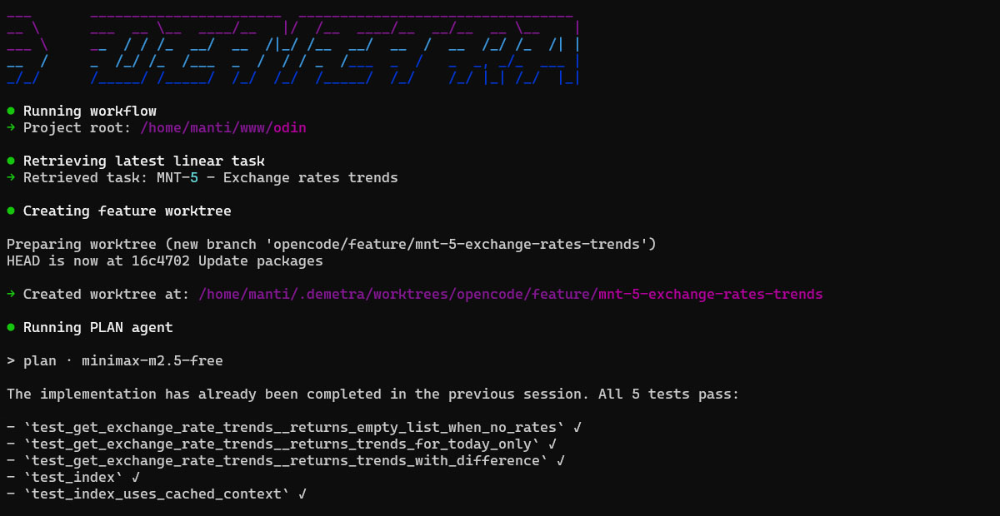
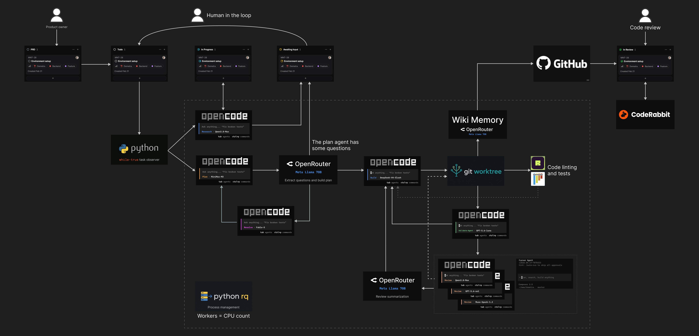

# Demetra


[](https://astral.sh/ruff)

An autonomous coding platform that coordinates multiple AI agents to automate software development end to end — from Linear issues or interactive web chats to reviewed, CI-checked pull requests. Integrates Linear, GitHub, OpenCode, Cursor, CodeRabbit, OpenRouter, WI, and optional Ruff/pytest CI loops.



## Features

- **Unified Task & Chat Orchestration**: Run autonomous workflows from Linear (`TODO` poller + `--linear-sync` local mirror) or web chats (Markdown templates, per-question inline answers compiled on rerun, and a read-only `Research` loop that persists reports and creates related Linear tickets).
- **Multi-Agent Pipeline & Typed Recovery**: OpenCode (`--standalone`) drives `plan`, `resolve`, `build`, post-build plan-coverage `validate`, `merge`, and `rebase` steps; Cursor, CodeRabbit, and multi-model OpenCode agents run code review in parallel; transient network, rate-limit, and in-flight budget failures retry with backoff and classify into redacted typed `AgentFailureError` comments (`Awaiting Input`).
- **GitHub PR Automation & CI Loops**: Notification listener and webhooks process `@demetra-ai merge` and `@demetra-ai rebase` (each followed by an automated `run_ci_loop` repair cycle), `@demetra-ai fix review findings`, and Redis-batched CodeRabbit review comments (`comments` workflow + thread resolution), posting immediate `"eyes"` reactions on command pickup.
- **Session History, Token Accounting & Pricing**: Exact per-invocation token deltas, nested MCP tool-usage stats, persisted failure reasons, and USD cost tracking across vendor-priced OpenCode runs and external providers (`OpenRouter`, `MiniMax`, and `DeepSeek` rate-card snapshots).
- **Git Worktree Management**: Isolated per-task worktrees reused across reruns by default (or recreated fresh via `WORKTREE_CLEANUP=true`) and automatically force-removed when a session is deleted.
- **MCP Tooling, OKF Wiki & Tracing**: Built-in Demetra MCP server (`database`, `docstrings`, `logs`), external `wi` MCP server over the Open Knowledge Format `wiki/` bundle, static Bearer-authenticated Linear MCP, and opt-in platform-wide LangSmith tracing (`SessionEnvironment.tracing_env`).

## Workflow

[](/media/dark-factory.png)

## Quick Start

```bash
# Install dependencies
uv sync --all-extras --dev

# Run migrations, frontend and backend apps
uv run alembic upgrade head
uv run fastapi dev demetra/app.py --host 0.0.0.0 --port 8081
cd react && bun run dev --host

# Add shared env and project via frontend app
# And run the project (auto mode enabled by default)
uv run main.py --project-name <project_name>
```

## Configuration

Set system defaults via `.env` (local) or `.env.docker` (Docker Compose); see [demetra/settings.py](demetra/settings.py) and [.env.docker.example](.env.docker.example) for all options, including opt-in `IS_RUFF_ENABLED` / `IS_PYTEST_ENABLED`, `WORKTREE_CLEANUP`, `MAX_*_ATTEMPTS` budgets, `PENDING_COMMENTS_TTL`, and platform-wide `LANGSMITH_*` tracing. Per-project and user-shared overrides (including encrypted `DB_PASSWORD`, `LINEAR_API_KEY`, and `OPENROUTER_API_KEY` entries) are resolved through `SessionEnvironment` and managed in the web UI.

## Deployment

The app layer (Postgres, Redis, API, `worker-blue` / `worker-green`, `watcher`, `listener`, `deployer`, `rq-dashboard`, plus one-shot `migrate`, `react-build`, `worker-swap`, and `worker-bootstrap` services) runs from `docker-compose.yaml` on the `mantiby/demetra:latest` image:

```bash
cp .env.docker.example .env.docker   # then fill in real values
make check-compose                   # validate docker-compose.yaml
make deploy                          # pull + build + migrate/react-build + worker swap + up services + nginx reload
make deploy-ui                       # pull + react-build + nginx reload (frontend-only, no API/worker restart)
make docker-build && make docker-up  # pure-Docker build + up, bootstrapping the recorded live worker slot
```

Workers run as two Compose generations, `worker-blue` and `worker-green` (4 replicas by default); the live slot is persisted in `deployer-state.json` (`/var/lib/demetra/deployer-state.json`). A deploy starts the staging generation on the new image, signals the live containers once so RQ finishes the workflow they hold, and reaps the drained containers on a later cycle; a watchdog force-stops workflows that outlive `SUBPROCESS_TIMEOUT` and `requeue_abandoned_jobs()` recovers their jobs. Neither the manual nor the automatic path waits for the queue to empty, and `make docker-up` runs `make worker-bootstrap` to scale whichever slot is recorded as live to 4 and the other to 0 (defaulting to `blue` on a fresh stack).

`make deploy`, `make deploy-ui`, `make worker-swap`, and `make worker-bootstrap` all acquire the same Redis deploy lock (`python -m demetra.deploy_lock`) as the `deployer` container, preventing overlapping manual and automatic deploys. The `deployer` service watches `origin/master`: it deploys a commit only when its GitHub check runs have all passed, at most once per `DEPLOY_MIN_INTERVAL`, and runs against the host checkout (`DEPLOY_HOST_CHECKOUT`, bind-mounted at itself) and the baked Docker CLI (`DOCKER_PATH=/usr/local/bin/docker`). Each cycle logs to `/var/log/demetra/deployer.log`, `docker compose stop deployer` disables automatic deploys without touching the rest of the stack, and a successful deploy ends by recreating `deployer` on the newly built image. See [the worker generation swap page](wiki/pages/2026-11-25-mnt-323-worker-generation-swap.md), [the deploy daemon page](wiki/pages/2026-11-14-mnt-315-auto-deploy-on-master-commits.md), and [the deploy deadlock recovery page](wiki/pages/2026-11-25-deploy-deadlock-container-cleanup.md); merging the watcher, listener, and deploy daemon into one watcher is tracked in [MNT-316](https://linear.app/mnt/issue/MNT-316/merge-the-watcher-listener-and-deploy-daemon-into-one-watcher).

## Development

```bash
make check         # Type checking (ty) + pre-commit (Ruff, Bandit)
make test          # Run pytest suite locally
make docker-test   # Run migrations + pytest against disposable Postgres in Docker
make ci            # Run a full CI pipeline
make docs          # Generate API documentation in docs/
uv run python -m demetra.services.wiki.okf --dry-run  # Validate the OKF wiki bundle
```

See [AGENTS.md](AGENTS.md), [wiki/README.md](wiki/README.md), and the [Wiki Index](wiki/INDEX.md) for architecture, conventions, and session history.
