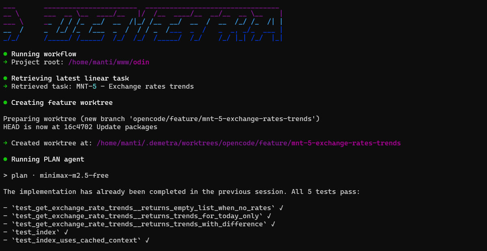
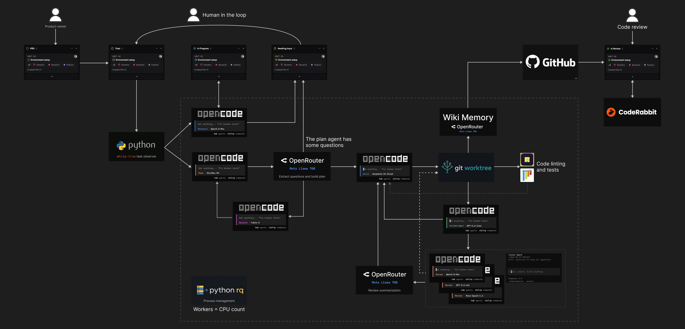

# Demetra


[](https://astral.sh/ruff)

An autonomous coding platform that coordinates multiple AI agents to automate software development. Integrates Linear (issues), OpenCode (plan/build/resolve/review), with automatic linting (Ruff) and testing (pytest).



## Features

- **Workflow Orchestration**: Coordinated development from task to a pull request.
- **OpenCode Integration**: AI-powered planning, building and review.
- **Build Loop**: Automatically resolve review agents findings, lint and test errors.
- **Linear Integration**: Task retrieval from Linear issue tracker.
- **Git Worktree Management**: Isolated feature development.
- **PostgreSQL**: Persistent storage for sessions and state.

## Workflow

[](/media/dark-factory.png)

## Quick Start

```bash
# Install dependencies
uv sync --all-extras --dev

# Run migrations, frontend and backend apps
uv run alembic upgrade head
uv run fastapi dev demetra/app.py --host 0.0.0.0 --port 8081
cd react && bun run dev --host

# Add shared env and project via frontend app
# And run the project (auto mode enabled by default)
uv run main.py --project-name <project_name>
```

## Configuration

Set environment variables via `.env` or shell, check [settings.py](demetra/settings.py) for the options.

## Deployment

The app layer runs from `docker-compose.yaml`:

```bash
cp .env.docker.example .env.docker   # then fill in real values
make deploy                          # pull + build + migrate + recreate + nginx reload
```

`make deploy` is the manual path. The `deployer` service watches `origin/master` instead: it deploys a commit only when the GitHub check runs for it have all passed and the default RQ job queue has drained, at most once per `DEPLOY_MIN_INTERVAL`, and runs the same steps against the host checkout, the host Docker daemon and the host nginx. Its knobs are the `DEPLOY_*` variables in `.env.docker` — `DEPLOY_HOST_CHECKOUT` must be the host path of the checkout the daemon deploys, because that path is bind-mounted at itself so `docker compose` recreates the host stack. Each cycle is logged to `/var/log/demetra/deployer.log` (next to the other daemons), and `docker compose stop deployer` turns automatic deploys off without touching the rest of the stack. A successful deploy ends by recreating the `deployer` container from the image it just built, so the daemon always runs the code it deployed. The design is documented in [the deploy daemon page](wiki/pages/2026-11-14-mnt-315-auto-deploy-on-master-commits.md); merging the watcher, the listener and the deploy daemon into one watcher is tracked in [MNT-316](https://linear.app/mnt/issue/MNT-316/merge-the-watcher-listener-and-deploy-daemon-into-one-watcher).

## Development

```bash
make check         # Type checking + pre-commit
make test          # Run tests
make ci            # Run a full CI pipline
make docs          # Generate API documentation in docs/
```

See [AGENTS.md](AGENTS.md) and [Wiki](wiki/INDEX.md) for development guidelines and detailed info.
